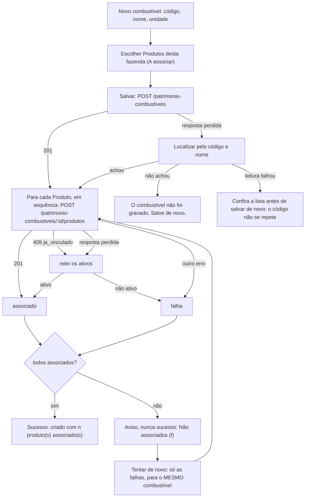
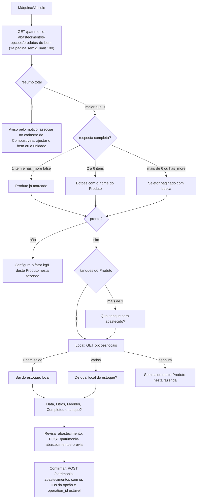
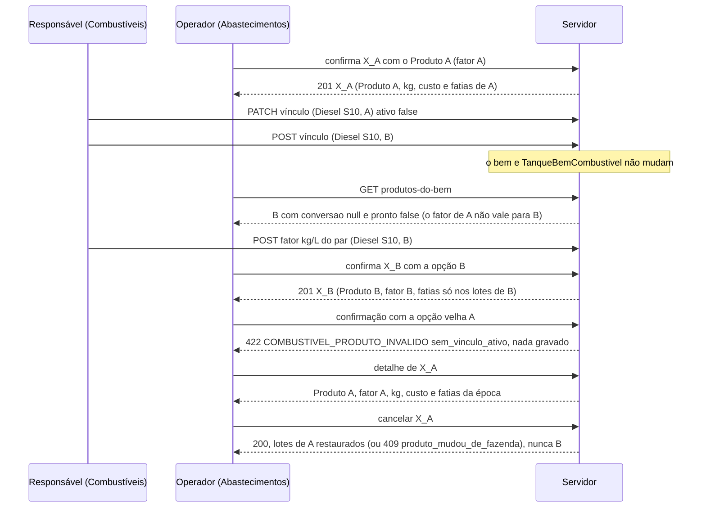

# MAIKE-PATRIMONIO-UX-02 — Abastecimento orientado pelo Produto associado ao combustível

Decisão: **D-PROD-160** ([`DECISIONS.md`](./DECISIONS.md)). Base: `origin/main` `e3ea4c39c5557c85a9f1f130a9c540af7e70f133` (merge da PR #235, Patrimônio P1-02).
Branch: `claude/maike-patrimonio-ux-02-abastecimento-produto` · PR [#237](https://github.com/maikelimaadm-stack/MAIKE/pull/237) (**DRAFT**) · HEAD final: ⟪PENDENTE: SHA do HEAD final da PR #237⟫.

> **Sem schema, sem migration, sem deploy.** `backend/prisma/schema.prisma` e as migrations não mudam: repositório e produção continuam com 39 migrations e 85 tabelas. Nenhuma API mutativa muda (corpos e respostas de prévia, confirmação, cancelamento, vínculo e fator iguais aos da P1-02). Todos os testes rodaram em PostgreSQL 16 **local e descartável** (socket `/tmp`, porta 5433, um banco por frente). Nada foi executado em Supabase, Vercel ou outro ambiente remoto. A PR fica em **DRAFT** até a revisão humana.

## 1. O que muda e o que fica igual

**Muda** (pedido do proprietário, que prevalece sobre a UX da P1-02):
- **Combustíveis** é onde cada fazenda associa os seus Produtos ao combustível, no próprio cadastro e na edição, vários de uma vez, inclusive ao criar o combustível.
- **Novo abastecimento** pede a máquina ou o veículo e, em seguida, o **Produto** pelo nome real. O tipo de combustível (ex.: "Diesel S10") deixa de ser etapa e rótulo do formulário. O servidor deriva o tipo, os tanques e o fator dos vínculos ativos.
- A troca do Produto associado vale para os **próximos** abastecimentos, sem editar o bem e sem reescrever o histórico.

**Fica igual:** o cadastro do bem e dos tanques (`TanquesBem.jsx`: combustíveis permitidos por tanque, flex = vários); o motor de estoque, FIFO, custo, medidor, estorno, RLS, travas e concorrência; os serviços mutativos do backend (`abastecimentoService.js`, `abastecimentoPlano.js`, `combustivelProdutoService.js`, `conversaoCombustivelService.js`, `tipoCombustivelService.js`); as permissões (nenhuma ação nova); `config/mapa-manejo-scope.json` (nenhuma página nova).

## 2. ANTES → DEPOIS

| Tela / fluxo | ANTES (P1-02) | DEPOIS (UX-02) |
|---|---|---|
| Combustíveis — novo cadastro | código, nome, unidade e descrição; nenhum Produto; a associação só existia depois, no registro gravado | os mesmos campos + seção **"Produtos associados nesta fazenda"** ("Fazenda: <nome>"): escolher 1..N Produtos antes de salvar. Salvar cria o combustível e associa cada Produto pelos endpoints existentes, com resultado explícito: todos associados → "Combustível criado com <n> produto(s) associado(s) nesta fazenda"; alguma falha → aviso (nunca sucesso) e "Não associados" com "Tentar de novo". Sem fazenda: aviso, o combustível é salvo sem Produtos |
| Combustíveis — registro gravado | "Produtos vinculados nesta fazenda", "Vincular produto" um por vez, lista única de ativos e inativos | "Produtos associados nesta fazenda" · "Fazenda: <nome>"; grupos **Associados (n)**, **Inativos (n)** e **Disponíveis** ("Associar produtos", vários de uma vez); "Inativar associação"/"Reativar associação" com o texto do efeito só no futuro |
| Combustíveis — edição | a seção saía da tela | a seção continua e grava na hora, com o aviso "As associações são gravadas na hora, independentemente do botão Salvar." |
| Combustíveis — troca de fazenda | a seção era relida | no cadastro novo, os Produtos escolhidos saem com aviso; se a fazenda muda durante o salvar, o combustível é criado e nenhum Produto é associado (aviso, nunca sucesso); no registro aberto, só a fazenda nova aparece |
| Bem / tanques | combustíveis permitidos por tanque | **igual**. Trocar o Produto associado não toca o bem nem `TanqueBemCombustivel` |
| Novo abastecimento — escolha | Bem → Tanque → **Combustível** → Produto → Local | **Máquina/Veículo → Produto** (nome real). Uma opção completa: já vem marcada. 2..6: botões. Mais de 6 ou `has_more`: seletor paginado com busca no servidor. Nenhuma: aviso pelo motivo do servidor |
| Tanque | sempre escolhido | "Qual tanque será abastecido?" só quando o Produto é aceito em mais de um tanque ativo |
| Local do estoque | seletor | "Sai do estoque: <local>" com um só local com saldo; "De qual local do estoque?" com vários (só o nome, sem kg nem lotes); "Sem saldo deste Produto nesta fazenda." com nenhum |
| Demais campos | data, litros, leitura, tanque cheio, observação e referência; estimativa de kg e custo no formulário | data (hoje da fazenda), litros, medidor (se houver), **"Completou o tanque?"** Sim/Não com explicação; observação e referência em "Mais detalhes"; kg e fator só na revisão |
| Produto sem fator | bloqueio só na prévia | rótulo "<nome> (sem fator kg/L)", aviso próprio separado do de associação e "Configurar fator kg/L" (só com `configurar_conversao`) |
| Revisão | "Pré-visualizar", dados técnicos misturados ao resumo | **"Revisar abastecimento"**: resumo humano e "Baixa no estoque: X kg"; **"Detalhes do estoque"** recolhido (tipo de combustível, tanque, fator e versão, custo estimado, saldo, FIFO). Mudar um campo invalida a revisão |
| Confirmação (API) | `tanque_id`, `tipo_combustivel_id`, `produto_id`, `conversao_id/versao` | **corpo idêntico**; os IDs vêm da opção do servidor, nunca de mapa no front nem de nome |
| Lista (desktop) | Nº, Data, Bem, Tanque, **Combustível**, Produto, Litros, KG, Custo, Leitura, Situação (`colunas_abastecimentos_v1`) | **Data, Máquina/Veículo, Produto, Litros, Medidor, Situação**; opcionais desligados: Nº, Tanque, KG, Custo, Tanque cheio, Referência; "Combustível" removida (`colunas_abastecimentos_v2`) |
| Lista (celular) | cards com Nº, data, litros, KG, situação e produto | cards com Máquina/Veículo, Produto, Litros e Data, sem rolagem horizontal |
| Consulta | "Combustível" ao lado do Produto | Produto primeiro; "Tipo de combustível (classificação)"; nenhum dado saiu do detalhe |
| Troca A→B | o formulário pedia o tipo; a troca não tinha fluxo próprio | trocar a associação em Combustíveis → o próximo abastecimento oferece B (depois do fator de B); o histórico de A fica intacto; a confirmação com a opção velha recebe 422 e a tela relê e avisa "O Produto escolhido deixou de estar disponível para este bem. Escolha de novo." |

## 3. Fluxos

### 3.1 Cadastro de Combustíveis com Produtos

### 3.2 Novo abastecimento por Produto

### 3.3 Troca A→B e histórico

## 4. Backend: uma rota nova, só de leitura (A16)

**Por que uma rota nova.** A tela precisa dos Produtos já filtrados por todo o caminho bem → tanques ativos → combustíveis permitidos (ativos, em L) → vínculo ativo na empresa → Produto ativo da empresa em KG → fator vigente, com o tipo derivado **no servidor**. As rotas existentes não serviam: `opcoes/tanques` + `opcoes/produtos?tipo_combustivel_id` exigiriam que o front escolhesse o tipo (a UX proibida) e N chamadas; `GET /bens-patrimoniais/:id/produtos-elegiveis` (P1-01) tem a guarda de Bens (quem só tem Abastecimentos levaria 403), não pagina, não traz fator e não filtra KG. Separar "falta associar", "falta fator" e "unidade ≠ KG" exige um resumo sobre o conjunto inteiro.

**Contrato.** `GET /patrimonio-abastecimentos-opcoes/produtos-do-bem?empresa_id&bem_id[&q][&cursor][&limit]`, `onRequest: [app.autenticar]`, `preHandler: [GUARDAS.patrimonioAbastecimentos.ver]`, query fechada (`q` ≤ 120, `cursor` ≤ 2200, `limit` 1..100, padrão 50). Resposta `{ bem, itens, has_more, next_cursor, resumo }`:
- `bem` = o mesmo objeto de `opcoes/tanques` (A8), com a leitura vigente; a resposta de A8 continua idêntica (o helper comum foi extraído e A8 conferido por `deepEqual`).
- Cada item: `id` = `produto.id`, `produto {id, nome, codigo_interno, unidade_principal_estoque}`, `tipo_combustivel {id, codigo, nome}`, `conversao {id, versao, sequencia, kg_por_litro}` (6 casas, texto) ou `null`, `tanques[]` (ordem identificador, id; capacidade em 4 casas), `bloqueios` ⊆ `['sem_fator']`, `pronto`. Ordem (nome, id), keyset.
- `resumo` (ignora `q` e `cursor`): `total`, `sem_fator`, `fora_de_kg`, `tipos_sem_produto [{id, nome}]`, `motivo_sem_opcao` ∈ `null | bem_inativo | sem_tanque_ativo | tanque_sem_combustivel | nenhum_produto_associado | produto_unidade_nao_kg`, não nulo ⇔ `total = 0`.
- Sem preço, saldo, custo ou lote.
- Erros: 401 `TENANT_CONTEXT_REQUIRED`; 403 `ACAO_NAO_PERMITIDA`; 400 `REQUEST_VALIDATION_FAILED` (sem `empresa_id`/`bem_id`, chave extra como `cliente_id`, `tipo_combustivel_id` ou `uso`, `limit` fora de 1..100); 400 `cursor_invalido`; empresa fora do tenant → o mesmo erro de A8; 404 `BEM_PATRIMONIAL_NAO_ENCONTRADO` com o **mesmo corpo** para bem inexistente, de outra fazenda e de outro tenant (sem oráculo).

**Implementação** (`backend/src/modules/patrimonio/abastecimentoOpcoesService.js`, `opcoesProdutosDoBem`):
- **Instantâneo único:** `emTransacao` RepeatableRead read-only (`maxWait` 2 s, `timeout` 9 s), sem `FOR …` nem trava consultiva — o padrão de leitura da prévia. Resumo e página saem do mesmo snapshot.
- `Produto.empresa_id = empresa` no próprio filtro (vínculo incoerente, de produto movido, nunca entra).
- Fator casado pelo **par exato** `(tipo, produto)`.
- Invariantes fail-closed (500 genérico, nunca resposta errada): mais de um vínculo ativo do mesmo Produto na empresa; Produto da página sem vínculo ativo de tipo aceito.
- Nenhum `Number` em quantidade ou fator.

**Rota** (`backend/src/modules/patrimonio/abastecimentoRoutes.js:203`), schema `OPCOES(['empresa_id','bem_id'], { bem_id: ID })`. Nenhuma outra rota mudou; a tela passa a 16 rotas, todas classe **a** ([cobertura](./MAIKE-PERMISSOES-R2-COBERTURA-ENDPOINTS.md), com os números de linha revistos).

## 5. Frontend

**Combustíveis** (`src/components/patrimonio/{CatalogoPatrimonioTela,FormularioCombustivel,ProdutosDoCombustivel,ProdutosNovoCombustivel}.jsx`, `src/services/combustivelProdutoService.js`):
- `associarProdutosAoCombustivel` (sequencial, nunca lança, resultado por Produto), `confirmarVinculoAtivo` (relê os ativos, até 20 páginas × 100) e `localizarCombustivelCriado` (código igual e nome igual sem caixa).
- Na criação, o POST do combustível sai com o corpo de sempre (`criarCatalogo` descarta `produtos_pendentes`); famílias, tipos e perfis não mudam.
- Falha nunca vira sucesso, inclusive parcial; "Tentar de novo" repete só as falhas, para o mesmo combustível; repetir nunca recria o combustível.
- Textos "associado/associação" no lugar de "vinculado"; `mensagemErroPatrimonio` (mensagens de erro do servidor) não foi alterada.

**Abastecimento** (`src/components/patrimonio/{FormularioAbastecimento,AbastecimentosTela,DialogosAbastecimento,ConsultaAbastecimento,TabelaAbastecimentos}.jsx`, `src/lib/abastecimentoRegras.js`, `src/lib/patrimonioErros.js` só na seção Abastecimentos, `src/services/abastecimentoService.js`, `src/apis/patrimonio/{patrimonioApi,patrimonioNativePort}.js`):
- Regras puras novas: `opcaoNoFormulario`, `produtoAutomatico`, `situacaoDaEscolha`, `tanqueDoFormulario`, `formatarLitrosCurto`. `formularioVazio`, `montarCorpo*`, `assinaturaDoFormulario`, `estimarKg`, `kgDaBaixaNaPrevia` e `conferirRespostaAbastecimento` inalterados (o INT-1 os importa).
- Auto-seleção só por `produtoAutomatico` (bem da resposta = bem do formulário, `has_more = false`, 1 item, consulta sem `q`); a resposta de outro bem nunca é usada; resposta completa sem a escolha → limpa e avisa, sem reescolher sozinho.
- `listOpcoesAbastecimento('produtos-do-bem')` exige `bem_id` e tem ramo próprio, que preserva `bem` e `resumo` (a paginação genérica descartava chaves extras).
- Link "Abrir Combustíveis" só com `criar` em `pat-combustiveis`; "Configurar fator kg/L" só com `configurar_conversao`.
- `sem_vinculo_ativo` → "O Produto não está mais associado ao combustível deste bem (cadastro de Combustíveis). Escolha o Produto de novo."

## 6. Matriz de cenários (missão, linha 68)

Arquivos: **PB** = `backend/tests/patrimonioUx02ProdutosDoBem.test.mjs`; **TA** = `backend/tests/patrimonioUx02TrocaAssociacao.test.mjs`; **S** = `backend/tests/patrimonioP1AbastecimentosSeguranca.test.mjs`; **AB/C** = `backend/tests/patrimonioP1Abastecimentos.test.mjs` / `…Concorrencia.test.mjs`; **INT-1** = `backend/tests/patrimonioP1AbastecimentosContratoTela.test.mjs`; **CB** = `tests/smoke/patrimonioUx02Combustiveis.test.jsx`; **UX-A** = `tests/smoke/patrimonioUx02Abastecimento.test.jsx`; **Regras** = `tests/smoke/abastecimentoRegras.test.js`; **FE** = `tests/smoke/patrimonioAbastecimentos.test.jsx`. "Registrado" = resultado anotado pela frente que escreveu o teste, antes do HEAD final.

| # | Caso da missão | Teste(s) | Status |
|---|---|---|---|
| 1 | Vínculos criados no cadastro de Combustíveis | CB-02 (2 POST exatos, vários de uma vez), CB-03 (novo combustível + 2 Produtos: 1 POST do combustível com o corpo de sempre + 2 POST de vínculo com o id novo); regressão `patrimonioP1CombustivelProduto` (API do vínculo); PB-05 (combustível novo sem Produto) | registrado PASS (CB 24/24; `patrimonioP1CombustivelProduto` 20/20; PB 14/14) · pela tela real: ⟪PENDENTE: E2E-2 do aceite humano (cadastrar "Diesel S10" escolhendo o Produto)⟫ |
| 2 | … inclusive falha parcial recuperável | CB-04 (2: 409 `COMBUSTIVEL_PRODUTO_EM_OUTRO_TIPO` no 2º → nunca sucesso, "Não associados (1)", "Tentar de novo" só ele ao MESMO combustível, combustível postado 1 vez; "Descartar"), CB-05 (4: resposta perdida gravada / não gravada / `ja_vinculado` / service nunca lança), CB-06 (3: criação incerta gravada, não gravada, conferência falha), CB-09 (403 na associação da criação) | registrado PASS (24/24); mutação "sucesso mesmo com falha" + "incerto = associado" derruba 4/24 |
| 3 | Troca da fazenda | CB-07 (3: cadastro novo, troca durante o salvar, registro aberto), CB-01 (nada da outra fazenda); PB-08 (mesmo S10 nas duas fazendas, bem da E1 pedido na E2 → 404, vínculo incoerente excluído) | registrado PASS |
| 4 | Inativação/reativação | CB-12 (textos e PATCH exatos; histórico listado), CB-10 (combustível inativo); PB-07 (vínculo, produto, fator, tipo, tanque e bem, sem editar o bem); TA-07 (reativar A com B ativo) | registrado PASS (CB, PB) · TA: ver nota A→B |
| 5 | Vários Produtos por combustível | PB-04 (2 Produtos, um sem fator), PB-10; TA-07 (A e B ativos, sem auto-seleção, cada um com o seu fator); UX-A02 (2 Produtos: nenhum marcado), UX-A03 (2..6 botões; mais de 6 → seletor) | registrado PASS |
| 6 | Multi-tanque/flex | PB-02 (flex Gasolina+Etanol), PB-03 (A+B ativos, C inativo; tanques de combustíveis diferentes; A4 no Tanque B); UX-A04 (2); UX-A05 (flex, Gasolina sem fator); TA-08 (gerador S10+S500); INT-1 (flex escolhido pelo `produto.id`) | registrado PASS |
| 7 | Combustível sem Produto | PB-05 (`nenhum_produto_associado`, `tipos_sem_produto`; `produto_unidade_nao_kg`); UX-A06 (7: cada motivo, link só com permissão, erro de leitura); TA-08 (`tipos_sem_produto [S10]`) | registrado PASS |
| 8 | Produto sem fator | PB-04, PB-06 (A3 → `ABASTECIMENTO_CONVERSAO_AUSENTE`, nada gravado); TA-02 (B sem fator; o de A não vale), TA-08 ((S500, A) sem fator); UX-A05 (2); FE4 ("fator ausente") | registrado PASS |
| 9 | Produto sem saldo | UX-A07 ("Sem saldo deste Produto nesta fazenda.", nada enviado); regressão AB7 (`ESTOQUE_SALDO_INSUFICIENTE`, nada gravado) | registrado PASS |
| 10 | Seleção única sem ignorar `has_more` | PB-10 (`limit=1` → 3 páginas, resumo igual nas 3); UX-A02 (página parcial → seletor, nada escolhido); UX-A09 (resposta atrasada do bem anterior não escolhe no bem novo); Regras (`produtoAutomatico`, `situacaoDaEscolha`); INT-1 (`unico` exige 1 item e `has_more:false`) | registrado PASS |
| 11 | Concorrência alteração do vínculo × confirmação | C7 (`patrimonioP1AbastecimentosConcorrencia.test.mjs:460`, ordem determinística por portões); TA-11 (`Promise.all`, 6 rodadas, os dois ramos `201` e `422 sem_vinculo_ativo` observados, nunca 409/500/40P01); PB-13 (opção velha, sequencial) | C7 registrado PASS (12/12, regressão) · PB-13 registrado PASS · TA-11: ver nota A→B |
| 12 | Histórico A→B | PB-12; TA-01..TA-04 (detalhe, linha da lista e linhas do banco de X_A idênticas; fator de B; FIFO só em B); UX-A10 (2) | PB-12 e UX-A10 registrado PASS · TA: ver nota A→B · pela tela real: ⟪PENDENTE: E2E-2 (troca A→B em Combustíveis, próximo abastecimento com B, histórico A intacto)⟫ |
| 13 | Cancelamento de A | PB-12 passo 7; TA-05 (associação atual = B → 200, lotes de A exatos), TA-05b (A movido de fazenda → 409 `produto_mudou_de_fazenda`, nada trocado para B), TA-06 (cancelar B); regressão AB11 (`patrimonioP1Abastecimentos.test.mjs:543`) | PB-12 e AB11 registrado PASS · TA: ver nota A→B · pela tela real: ⟪PENDENTE: E2E-2 (cancelar A devolve os lotes de A)⟫ |
| 14 | Idempotência | TA-09 (replay 200 com a mesma `operation_id`, inclusive depois da troca; mesma chave com Produto A → 409 `IDEMPOTENCY_CONFLICT`); UX-A11 ("Repetir o mesmo envio" conserva o `operation_id`); FE5 (duplo clique, 504, Consultar, FE-02/03/06); CB-05/CB-06 (vínculo e criação sem duplicar) | UX-A, FE, CB registrado PASS · TA: ver nota A→B |
| 15 | Permissão | PB-11 (só visualizar 200; sem a linha ou só a de Bens 403; sem token 401); S1/S2 (16 rotas, 12 contas), S3 (bem de outro tenant → 404 igual ao inexistente), S4 (`cliente_id` → 400); CB-09 (4); UX-A05 (`configurar_conversao`), UX-A06 (link só com `criar` em `pat-combustiveis`) | registrado PASS (S 9/9) |
| 16 | Prévia invalidada | TA-10 (vínculo inativado entre prévia e confirmação → 422; fator trocado → 409 `ABASTECIMENTO_CONVERSAO_ALTERADA`); PB-13; UX-A11 (mudar "Completou o tanque?" invalida); FE4 | PB, UX-A, FE registrado PASS · TA: ver nota A→B |
| 17 | Teclado/mobile | UX-A13 (2: `role="radio"`/`aria-checked`, `aria-expanded`, botões nativos, sem largura fixa; "Mais detalhes" abre com erro); UX-A12 (390 px: cards, sem tabela) | registrado PASS (jsdom) · navegador real: ⟪PENDENTE: Playwright 390/820/1280 px, sem rolagem horizontal em 390⟫ |
| 18 | Testes reais com PostgreSQL local descartável | §8 | registrado PASS nos arquivos listados · ⟪PENDENTE: `npm run test:backend` completo no HEAD final⟫ |
| 19 | Smoke RTL | §8 | registrado PASS · ⟪PENDENTE: `npm run test:smoke` completo no HEAD final⟫ |
| 20 | Playwright 390/820/1280 px | E2E-1 (`scripts/dev/e2e-abastecimentos-real.mjs`, larguras padrão `1280,820,390`; a frente registrou só `node --check`) e E2E-2 do aceite humano (`scripts/dev/e2e-abastecimentos-ux02-real.mjs`) | ⟪PENDENTE: E2E-1 real (passos, larguras, exit code, divergências de banco)⟫ · ⟪PENDENTE: E2E-2 real (passos, capturas 390/820/1280)⟫ |
| 21 | `verify:all` e CI completos, sem ignorar testes | — | ⟪PENDENTE: `npm run verify:all` no HEAD final (etapas, contagens, duração)⟫ · ⟪PENDENTE: CI da PR #237 (run, conclusão, duração)⟫ |

**Nota A→B (TA-01..TA-11).** A frente do cenário obrigatório registrou `patrimonioUx02TrocaAssociacao` **12/12** em 4 execuções seguidas (a 1ª deu 11/12: TA-05b caía no unique de nome do Produto homônimo da Fazenda 2; corrigido no fixture), mais `patrimonioUx02ProdutosDoBem` 14/14, `patrimonioP1Abastecimentos` 17/17, `patrimonioP1AbastecimentosConcorrencia` 12/12 e `patrimonioP1CombustivelProduto` 20/20 (5 arquivos, 75/75, banco `maike_ux02_ab`). ⟪PENDENTE: reexecução do cenário A→B PG-real no HEAD final e resultado da mutação que prova que TA-01..TA-11 mordem⟫.

## 7. Arquivos alterados

Levantado com `git diff --name-status origin/main...HEAD` e `git status` durante a fase de documentação (a branch ainda recebia checkpoints).

- **Backend, código (2):** `backend/src/modules/patrimonio/abastecimentoOpcoesService.js` (`opcoesProdutosDoBem` e helpers comuns com A8), `backend/src/modules/patrimonio/abastecimentoRoutes.js` (rota A16, schema, comentário do topo).
- **Backend, testes (6):** novos `backend/tests/patrimonioUx02ProdutosDoBem.test.mjs` (PB-01..PB-14) e `backend/tests/patrimonioUx02TrocaAssociacao.test.mjs` (TA-01..TA-11 + TA-05b); alterados `backend/tests/patrimonioP1AbastecimentosSeguranca.test.mjs` (A16 em S1–S4), `backend/tests/patrimonioP1AbastecimentosContratoTela.test.mjs` (INT-1: bens → produtos-do-bem → locais), `backend/tests/patrimonioP1AbastecimentoCenario.mjs` (helper `produtosDoBem` e comentário).
- **Frontend (16):** `src/components/patrimonio/{AbastecimentosTela,CatalogoPatrimonioTela,ConsultaAbastecimento,DialogosAbastecimento,FormularioAbastecimento,FormularioCombustivel,ProdutosDoCombustivel,TabelaAbastecimentos}.jsx`, novo `src/components/patrimonio/ProdutosNovoCombustivel.jsx`, `src/lib/{abastecimentoRegras,patrimonioErros}.js`, `src/services/{abastecimentoService,combustivelProdutoService}.js`, `src/apis/patrimonio/{patrimonioApi,patrimonioNativePort}.js`.
- **Smoke (8):** `tests/smoke/{abastecimentoRegras.test.js,patrimonioAbastecimentos.test.jsx,patrimonioCatalogos.test.jsx,patrimonioCombustivelProdutos.test.jsx}`, `tests/smoke/fixtures/{abastecimentosFakeCore.js,abastecimentosTela.jsx}`, novos `tests/smoke/patrimonioUx02Abastecimento.test.jsx` (UX-A01..A13, 27 testes) e `tests/smoke/patrimonioUx02Combustiveis.test.jsx` (CB-01..CB-12, 24 testes).
- **E2E, fora do CI (3):** `scripts/dev/e2e-abastecimentos-real.mjs` (E2E-1 no fluxo novo), novos `scripts/dev/e2e-abastecimentos-ux02-real.mjs` e `scripts/dev/e2e-abastecimentos-ux02-seed.mjs` (E2E-2).
- **Docs (5):** `docs/engineering/DECISIONS.md` (D-PROD-160; atualização de estado da D-PROD-159), `docs/engineering/CURRENT-STATE.md`, `docs/engineering/ROADMAP.md`, `docs/engineering/MAIKE-PERMISSOES-R2-COBERTURA-ENDPOINTS.md` (linha A16 e números de linha), este relatório.
- **Não tocados:** `backend/prisma/**`, `config/**`, `TanquesBem.jsx`, `src/hooks/**`, `operacaoFinanceiraService.js`, `patrimonioCatalogoService.js` e os serviços mutativos do backend listados no §1.

⟪PENDENTE: `git diff --stat origin/main...HEAD` do HEAD final (arquivos, inserções, remoções)⟫ · ⟪PENDENTE: confirmar que `abastecimentoService.js` e `abastecimentoPlano.js` não têm diff contra `origin/main` no HEAD final — checkpoints intermediários da branch capturaram mutantes temporários do teste de mutação nesses arquivos⟫.

## 8. Provas de testes

Comando por arquivo de backend: `DATABASE_URL="postgresql://postgres@localhost:5433/<banco>?host=/tmp" AUTH_SECRET=ci-only-ephemeral-signing-key FRONTEND_ORIGINS=http://localhost:5173 NODE_ENV=test MAIKE_TESTE_AGORA=2027-06-15T15:00:00.000Z node --test --test-concurrency=1 backend/tests/<arquivo>.test.mjs`, banco próprio criado do zero e migrado com `npm run deploy:migrate` ("All migrations have been successfully applied").

**Linha de base** (antes de qualquer edição): 7 arquivos de smoke, 125/125.

| Suíte | Banco / ambiente | Resultado registrado | Duração |
|---|---|---|---|
| `patrimonioUx02ProdutosDoBem` (PB-01..PB-14) | `maike_ux02_be` | 14/14 | 23 s |
| `patrimonioP1AbastecimentosSeguranca` (A16 em S1–S4) | `maike_ux02_be` | 9/9 | 15 s |
| `patrimonioP1AbastecimentosContratoTela` (INT-1, mapeamento inline) | `maike_ux02_be` | 3/3 | 7 s |
| Regressão: `patrimonioP1Abastecimentos` 17/17 · `…Concorrencia` 12/12 · `…Medidor` 8/8 · `patrimonioP1CombustivelProduto` 20/20 · `patrimonioP1Bens` 19/19 · `permissoesAutorizacao` 11/11 · `permissoesR2` 10/10 · `permissoesR2Rotas` 7/7 · `permissoesR3` 9/9 · `permissoesR4` 9/9 | `maike_ux02_be` | verde | — |
| Total da frente backend | `maike_ux02_be` | **13 arquivos, 148/148** | — |
| `patrimonioUx02TrocaAssociacao` (TA-01..TA-11 + TA-05b) + 4 de regressão | `maike_ux02_ab` | 12/12 (4 execuções); **5 arquivos, 75/75** | 21 s (arquivo novo) |
| Smoke Combustíveis: `patrimonioCombustivelProdutos`, `patrimonioCatalogos`, `patrimonioUx02Combustiveis`, `produtosBloqueioCombustivel` | jsdom | **4 arquivos, 89/89** | — |
| Smoke Abastecimento: `patrimonioAbastecimentos` 24 · `…Cancelamento` 4 · `…Conversoes` 6 · `patrimonioUx02Abastecimento` 27 · `abastecimentoRegras` 33 | jsdom | **5 arquivos, 94/94** | — |
| Smoke completo (`npx vitest run --config vitest.config.js tests/smoke`) | jsdom | 179 arquivos 2253/2253 (frente Combustíveis) · 180 arquivos 2287/2287 (frente Abastecimento, árvore posterior) | — |
| `npm run typecheck:backend` · `npx eslint backend` · `gate:tenancy` (84 models, 234 arquivos) · `gate:indices` | — | rc 0 · rc 0 · PASSOU · PASSOU | — |
| `npm run lint` · `gate:types` (809 ≤ 1746) · `gate:product-scope` (28 páginas, 35 entidades) · `gate:import-integrity` (586 arquivos) · `NODE_ENV=production npm run build` · `node --check` do E2E-1 | — | 0 erros (2 avisos antigos, fora da missão) · PASSOU · PASSOU · PASSOU · ok · ok | — |
| INT-1 com `opcaoNoFormulario` (no lugar do mapeamento inline) | PG local | ⟪PENDENTE: resultado⟫ | — |
| `npm run test:backend` completo | PG local, banco vazio | ⟪PENDENTE: arquivos, testes, pass, fail, todo⟫ | — |
| E2E-1 (`scripts/dev/e2e-abastecimentos-real.mjs`, 1280/820/390) | backend real + Vite + Chromium | ⟪PENDENTE: passos, exit code, divergências⟫ | — |
| E2E-2 do aceite humano (`scripts/dev/e2e-abastecimentos-ux02-real.mjs`) | idem | ⟪PENDENTE: passos, exit code, capturas⟫ | — |
| `npm run verify:all` no HEAD final | todas as etapas | ⟪PENDENTE: n/n PASS, contagens, duração⟫ | — |
| CI (GitHub Actions) | `verify:all` | ⟪PENDENTE: run, conclusão, duração⟫ | — |

**Sensibilidade (mutação, serviço restaurado e conferido com `cmp`):** sem `empresa_id` no filtro do Produto → PB-08 vermelho; sem o filtro KG → PB-05 vermelho; fator de qualquer par do Produto → PB-04 vermelho; `comFator` sem exigir vínculo ativo de tipo aceito → 7 testes vermelhos. Na tela de Combustíveis, "sucesso mesmo com falha" + "incerto = associado" → 4/24 vermelhos (CB-04, CB-05 ×2, CB-09). ⟪PENDENTE: mutação do cenário A→B (cancelamento pelo vínculo atual, fingerprint sem `produto_id`/conversão etc.) e resultado⟫.

**Citados, não duplicados:** corrida real vínculo × confirmação = C7 (`patrimonioP1AbastecimentosConcorrencia.test.mjs:460`); cancelamento com Produto movido de fazenda = AB11 (`patrimonioP1Abastecimentos.test.mjs:543`).

## 9. Limitação de API

- **Um Produto, um combustível ativo por fazenda** (unique `TipoCombustivelProduto_produto_ativo_key`): o mesmo "Diesel" não serve S10 e S500 ao mesmo tempo na mesma fazenda (409 `COMBUSTIVEL_PRODUTO_EM_OUTRO_TIPO`, mostrado na tela). Mudar isso exige schema.
- **Fator por par** `(empresa, tipo, produto)`: B nasce sem fator; o de A nunca é reaproveitado. Confirmar sem `conversao_id/versao` é barrado no schema (400 `required`); com o fator de outro par → 422 `ABASTECIMENTO_CONVERSAO_AUSENTE`. A tela não chega a enviar nenhum dos dois: o aviso de fator vem antes.
- **`TanqueBemCombustivel` sem coluna `ativo`:** a compatibilidade do tanque é a linha existente. A UX-02 nunca grava essa tabela.
- **Sem endpoint atômico "criar combustível + associar":** a criação usa os endpoints existentes, em sequência. Um resultado parcial é possível e fica explícito na tela, com repetição só do que falhou. `POST /patrimonio-combustiveis` **não é idempotente**: depois de uma resposta perdida, a tela procura o combustível pelo código único (e nome); se essa leitura falhar, pede conferência manual, e salvar de novo dá 409 de código duplicado, nunca um segundo combustível.
- **Leitura sem trava:** a opção pode envelhecer entre a tela e a confirmação; a barreira é a confirmação (trava do vínculo, R5 da D-PROD-159), que recusa com 422 `sem_vinculo_ativo`.
- **Dados vivos no detalhe:** `kg_por_litro`, `quantidade_kg`, custo e fatias são snapshot do abastecimento; o **nome** do Produto e `conversao.versao`/`conversao.vigente` do detalhe são lidos ao vivo (TA-03: encerrar o fator de A muda `versao` 1 → 2 e `vigente` para `false` no detalhe antigo, sem mudar kg, custo ou fatias).
- **Dois contratos de elegibilidade convivem:** `GET /bens-patrimoniais/:id/produtos-elegiveis` (P1-01, guarda de Bens) fica como está; o formulário usa só A16. `opcoes/tanques` (A8) continua servida, mas o formulário não a chama.
- **Locais** vêm de `opcoes/locais` (A12, exige `novo`/`salvar`): quem só tem `visualizar` vê os Produtos, mas não chega à escolha do local (e não pode confirmar).
- **Mensagens de erro do servidor** (`mensagemErroPatrimonio`, intocada) ainda dizem "vinculado" em alguns textos.

## 10. Riscos

- **R1 — unicidade Produto ↔ combustível:** limita fazendas que usam o mesmo Produto para dois combustíveis; a tela mostra o conflito, a mudança exige schema.
- **R2 — passo extra de fator:** depois de trocar A por B, o responsável precisa configurar o fator de B antes do próximo abastecimento (comportamento desejado, fail-closed).
- **R3 — opção velha:** coberta pela confirmação sob trava (C7, PB-13, TA-10, TA-11) e pela releitura da tela (UX-A10).
- **R4 — criação não idempotente:** se o servidor gravar o combustível depois da conferência, "Salve de novo" leva a 409 de código duplicado (legível); os Produtos se associam então na seção do registro. A memória de falhas guarda só a última criação com falha.
- **R5 — custo de leitura:** 4 contagens + 1 `groupBy` + a página por chamada, inclusive nas páginas do seletor; limitado por bem e pelo índice `TipoCombustivelProduto_empresa_tipo_ativo_idx`. ⟪PENDENTE: tempo de resposta medido no E2E⟫.
- **R6 — preferências de coluna:** a chave nova `colunas_abastecimentos_v2` faz cada usuário perder, uma vez, a escolha de colunas salva na P1-02 (de propósito: a preferência antiga traria a coluna "Combustível" de volta).
- **R7 — conflito de texto com a PR #229** (aberta, D-PROD-154): ela acrescenta 89 linhas em `docs/engineering/DECISIONS.md` logo depois da D-PROD-153 (por volta da linha 5529), sem remover nenhuma e sem tocar o marcador de próxima decisão. A UX-02 escreve depois da D-PROD-159 (fim do arquivo) e troca o marcador para D-PROD-161. Os trechos são distantes; o conflito é improvável, mas quem mergear a segunda deve conferir o fim do `DECISIONS.md` e a ordem dos IDs. A UX-02 não toca a PR #229.
- **Responsividade em navegador** ainda não medida (só classes e jsdom): ⟪PENDENTE: E2E 390/820/1280⟫.

## 11. O que NÃO foi feito

- Nenhuma migration, nenhum DDL, nenhum SQL em banco remoto; nenhum deploy; nenhuma variável Vercel; nenhum merge; PR não marcada como ready.
- Nenhuma mudança em schema, motor de estoque/FIFO, custo, medidor, estorno, RLS, travas, concorrência ou API mutativa; nenhum endpoint mutativo novo; nenhum CRUD paralelo de vínculo.
- `TanquesBem.jsx`, mapas, financeiro e outros módulos intocados; PR #235 (mergeada) e PR #229 (aberta) intocadas.

## 12. Situação

| Item | Valor |
|---|---|
| PR | [#237](https://github.com/maikelimaadm-stack/MAIKE/pull/237), **DRAFT** |
| Branch | `claude/maike-patrimonio-ux-02-abastecimento-produto` |
| Base | `origin/main` `e3ea4c39` |
| HEAD final | ⟪PENDENTE: SHA do HEAD final⟫ |
| CODE_READY | ⟪PENDENTE: SIM ou NÃO, com `verify:all` e CI no HEAD final⟫ |
| SCHEMA | sem mudança (nenhuma migration a aplicar) |
| MERGE_READY | **NÃO** — PR em draft; depende da revisão humana e do merge manual do proprietário. Não há passo de banco antes do merge |
| OPERATIONAL_RELEASE_READY | NÃO — depende do merge; a Vercel publica a `main` sozinha e não há migration |

Decisões para aprovação humana: a própria D-PROD-160 (U1–U9 e as divergências registradas), os limites aceitos (§9) e o merge manual.
